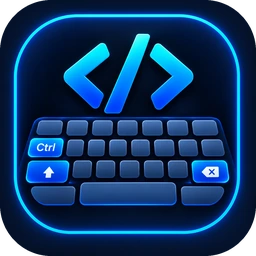
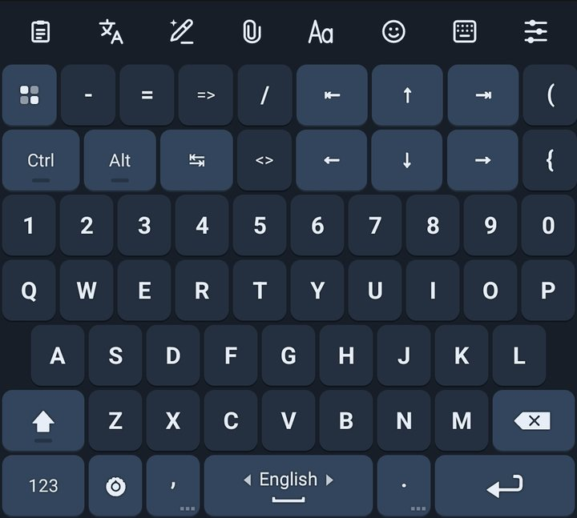
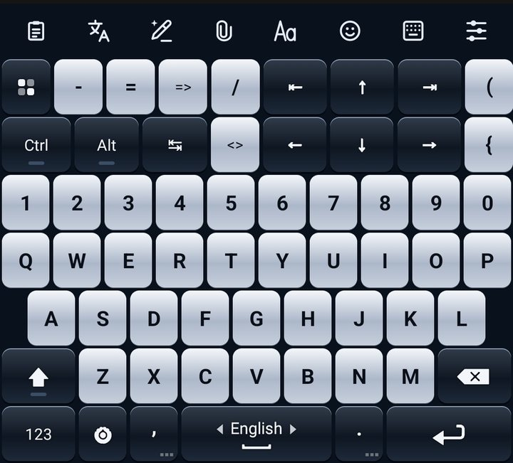
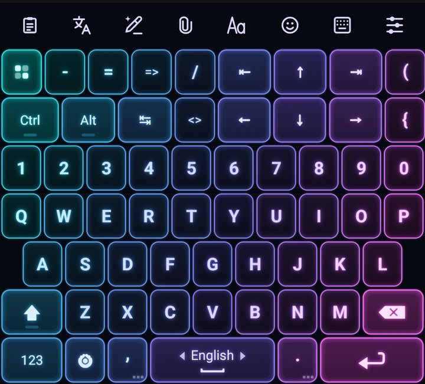

<div align="center">



# Mr Keyboard

**An Android keyboard for power users: full PC keys, editable key sheets, Tasker commands, gesture typing, AI editing and private offline suggestions.**

[](https://github.com/x-mrrobot-x/mr-keyboard/releases/latest)
[](https://github.com/x-mrrobot-x/mr-keyboard/releases)
[](https://github.com/x-mrrobot-x/mr-keyboard/actions/workflows/mr-checks.yml)
[](#installation)
[](LICENSE)

**English** · [Português](README.pt-BR.md)

[Download](https://github.com/x-mrrobot-x/mr-keyboard/releases/latest) · [Features](#features) · [Installation](#installation) · [Privacy](#privacy) · [Building](#building)

<br>





<sub>Midnight Steel (default) · Chrome · Aurora, three of the twelve themes</sub>

</div>

Mr Keyboard is based on [Hacker's Keyboard](https://github.com/klausw/hackerskeyboard). It is open source, has no ads, no analytics and no Google Play Services, and what you type never leaves your phone.

## Features

### Keys and layout
- **Full PC keyboard:** Ctrl, Alt, Esc, Tab, arrows, Home/End, PgUp/PgDn and function keys, in compact or full layout (separate settings for portrait and landscape).
- **Key sheets:** extra pages of keys opened from the keyboard: **123**, **TSK** (Tasker), **HTML**, **FRS** (phrases), navigation and numeric pad. Edit them and create your own in *Settings → Sheets*.
- **Tasker commands:** a key can trigger a Tasker task instead of typing text ([how](#tasker-integration)).
- **Gestures:** swipe up, down, left or right, and the volume keys, run keyboard actions (by default left and right change the sheet). A sideways swipe counts by distance, not by speed. [Details](docs/swipe-actions.md).
- **Delete by word (since 2.0.0, off by default):** with Ctrl on, the delete key removes a word per tap, and held it goes word by word at the interval you set. **Ctrl + Z** gives the words back one at a time and **Ctrl + Y** deletes again the one that came back (kept for 2 minutes). *Settings → Touch and gestures → Delete by word*. [Details](docs/word-delete.md).
- **Your own look:** twelve themes, key spacing, corner roundness, label size, keyboard height (portrait and landscape) and toolbar height. Long press, vibration strength, click volume and key preview are adjustable.

### Toolbar
- **Clipboard:** history of what you copied; tap to insert, hold to delete.
- **Translate:** translate text before sending it (Google Translate).
- **Edit with AI:** rewrite the selected text, or the text before the cursor, in a dialog above the keyboard. Styles: Formal, Short, Correct, Expand, Friendly, Professional, Punctuation and your own; optional emojify. Use any OpenAI-compatible (Chat Completions) service with your own address (https), model and key. [Details](docs/ai-editor.md).
- **Attachments:** photos, videos and files inserted into the app you are typing in, with multiple selection and batch sending.
- **Fonts:** 27 text styles (bold, italic, cursive, gothic, bubble, small caps, strikethrough and more) that work in any app.
- **Emojis:** recent, all categories, 170 newer emojis (shown only when your phone font can draw them) and **search** in Portuguese, English and Spanish at once ("coração", "heart" and "corazón" find the same emoji). [Details](docs/emoji-search.md).
- **Customize keyboard:** quick adjustment of height, key spacing, label size, key roundness and toolbar height, with a reset button.
- **Show/hide:** the grid key at the top left of the keyboard hides or shows the toolbar; the tools come back by themselves after you type (time is adjustable).

### Typing
- **Suggestions, correction and next-word prediction** in Brazilian Portuguese, US English and Spanish, fully on the device (off by default: turn on *Show suggestions* in *Settings → Suggestions and dictionaries*).
- **Small app:** dictionaries are downloaded on demand, so the app itself is about 1 MB. Each language you download is added to the keyboard: slide the space bar sideways to switch between them.
- **Learns what you type** (never in password or incognito fields) and suggests the names and words you just wrote in the same conversation (kept only in memory).
- **My words:** *Settings → Suggestions and dictionaries → My words* shows what the keyboard learned, lets you fix, block and forget words (with an exported backup) and add names, slang and phrases from a pasted text, a file or a list, with a preview before saving. **Format with AI** turns a loose text into that list.
- **Gesture typing (off by default):** slide your finger from letter to letter and the keyboard writes the word, in the three languages. It also writes your own words, never a blocked one, and shows the word on the suggestion strip while you slide. Needs a one-time download of about 2.4 MB, then runs on the device. *Settings → Suggestions and dictionaries → Gesture typing*. [Details](docs/gesture-typing.md).
- **Auto-capitalization** (on by default) and **voice input**.

### Themes
Twelve themes: **Midnight Steel** (default); the neon ones **Aurora** (keys change hue across the keyboard), **Neon Cyan**, **Neon Purple**, **Neon Pink** and **Synthwave**; the light ones **Aqua**, **Snow** and **Rose**; **Chrome** (silver keys on navy); **Cobalt Glass** (translucent) and **Denim**, both with background blur on Android 12 or newer. Ctrl, Alt and Shift show their state with a small colored dash (Shift: off, active, locked). How to add one: [docs/new-theme.md](docs/new-theme.md).

### App
- **Languages:** Portuguese, English and Spanish; follows the system or pick one in *Settings → General → App language*.
- **Updates inside the app:** notice of new versions with what's new, **Download and install** and a signed, checked APK ([how it works](#updates)).
- **Performance:** *Settings → Advanced → Performance → Keyboard times* shows how long the keyboard takes to open, type and suggest on your phone.
- **Restore defaults** in *Settings → General*.

## Installation
Requires Android 8.0 or later.

1. Download the APK (`mr-keyboard-v<version>.apk`) from the [latest release](https://github.com/x-mrrobot-x/mr-keyboard/releases/latest) and install it.
2. Open **Mr Keyboard** and tap **Enable keyboard**. Turn on Mr Keyboard in the list and accept the system warning. Android shows that warning for every keyboard that doesn't come with the phone.
3. Tap **Set input method** and choose Mr Keyboard.
4. For word suggestions (optional): in the settings, open **Suggestions and dictionaries**, tap your language to download its dictionary, then turn on **Show suggestions**. Download more than one language and slide the space bar sideways to switch between them.

## Updates
- The app looks for a new version when it opens (at most once a day) and every morning in the background. When there is one, a dialog (or a notification, for the morning check) shows what's new, with **Download and install**, **Open on GitHub** and **Not now**. The **Check for updates** line and the two switches are in *Settings → About*, where tapping **Version** shows the notes of the installed version, with no network.
- **Download and install** downloads the APK of that release, checks its size and SHA-256 against the signed `update.json` and hands it to Android, which asks you to confirm. The first time, Android also asks you to allow Mr Keyboard to install apps (*Install unknown apps*).
- The morning check asks Android to run it some time after 8 a.m. (phone time), when there is a network. Android decides the exact moment: with battery saver, or on phones that put apps to sleep (some Samsung, Xiaomi and Huawei models, for example), the notice can arrive hours late or not at all. The check when the app opens always runs. On Android 13 or newer, the notice needs the notification permission.
- You can also update by hand: download the new APK from the [latest release](https://github.com/x-mrrobot-x/mr-keyboard/releases/latest) and install it over the old one (it has to be signed with the same key).

## Tasker integration
Any key whose output text starts with `tskcmd:` sends a command instead of typing. The first row of the **TSK** sheet already has some, and you can create your own in the sheet editor (e.g. output text `tskcmd:lights_on`).

In Tasker:
1. Create a profile: *Event → System → Intent Received*.
2. Set *Action* to `com.mrkeyboard.app.TASKER_CMD`.
3. In the task, the variable `%cmd` holds the command (in the example, `lights_on`).

The command is sent as a broadcast that other apps can also receive, so don't put passwords or private data in it.

## Privacy
- What you type stays on your device. Suggestions, corrections and learned words are processed and stored only on the phone. There are no ads, no analytics and no Google Play Services.
- The app connects to the internet only for these features:
  - **Translate** sends the text you type in the translate field to Google Translate (`translate.googleapis.com`). Only that text is sent, and only when you use it. The field says so ("Type to translate with Google").
  - **Edit with AI** sends only the text you choose to rewrite, and only to the AI service you configure. No request is sent until you tap a style.
  - **Dictionaries** (*Settings → Suggestions and dictionaries*): the app only connects when you tap *Check for updates*, *Download*, *Update* or a language that isn't downloaded yet, and it only downloads files from this repository's [latest release](https://github.com/x-mrrobot-x/mr-keyboard/releases/latest) (the catalog, `catalog.json`, and the zip of each language, which is attached to the release where that language last changed). Every file is checked against a list signed with the app's own key before it is used.
  - **Gesture typing** (same screen): the file it needs (the gesture recognition) is downloaded the same way, from the same releases, and only when you tap *Download* or *Update* in its dialog; *From a file* installs it with no connection at all. After that the recognition runs on the phone: the path of your finger is not sent anywhere.
  - **App updates** (*Settings → About*): the app reads `update.json` from this repository's [latest release](https://github.com/x-mrrobot-x/mr-keyboard/releases/latest) when it opens (at most once a day) and every morning in the background, and shows a notice when there is a newer version. Both can be turned off. The request carries nothing about you or your phone. The file is checked against a signature made with the app's own key before it is used.

| Permission | Why |
|---|---|
| Internet | Translate, Edit with AI, dictionary and gesture recognition downloads, and update notices |
| Notifications | Optional permanent notification to bring up the keyboard, and the new-version notice |
| Install unknown apps | *Download and install* hands the new APK to Android, which asks you to confirm |
| Run at startup | Keeps the morning update check scheduled after the phone restarts |
| Storage / All files access | Attachments: list and send your photos, videos and files |
| User dictionary | Read and add words to Android's personal dictionary |
| Vibration | Vibrate on keypress |

## Building
The repository is an [apktool](https://apktool.org/) project (smali code and resources), plus `native/` (C++ dictionary reader, `libjni_pckeyboard.so`), `engine/` (native suggestion engine, `libmrengine.so`), `dicts/` (dictionary packs), `gesture/` (gesture recognition data) and `docs/` (notes of each version and the tools).

```sh
apktool b . -o mr-keyboard-unsigned.apk
zipalign -p -f 4 mr-keyboard-unsigned.apk aligned.apk
apksigner sign --ks your-key.jks --out mr-keyboard.apk aligned.apk
```

Every release also has `mr-keyboard-v<version>-source.zip`, made from the exact commit that was published. Build from a source zip, GitHub Actions workflows, signing, dictionaries and how a release is published: **[docs/building.md](docs/building.md)**.

## Documentation
[Building and publishing](docs/building.md) · [Gesture typing](docs/gesture-typing.md) · [Delete by word](docs/word-delete.md) · [Swipe actions](docs/swipe-actions.md) · [Emoji search](docs/emoji-search.md) · [Edit with AI](docs/ai-editor.md) · [Suggestion features](docs/suggestion-features.md) · [Native engine](docs/native-engine.md) · [Performance meter](docs/performance-meter.md) · [New theme](docs/new-theme.md) · [Release notes](docs/release-notes)

## Verifying a release
Releases are [immutable](https://docs.github.com/en/code-security/concepts/supply-chain-security/immutable-releases) (see [Publishing](docs/building.md#publishing-maintainers)): after publication their files and tag can't be changed. The APK and the source zip are built by the *Mr Keyboard - APK* workflow of this repository from the tagged commit, and each has a signed provenance attestation. With the [GitHub CLI](https://cli.github.com/), in the folder where you saved the file (replace the version):
```sh
gh release verify v2.0.0 --repo x-mrrobot-x/mr-keyboard
gh release verify-asset v2.0.0 mr-keyboard-v2.0.0.apk --repo x-mrrobot-x/mr-keyboard
gh attestation verify mr-keyboard-v2.0.0.apk --repo x-mrrobot-x/mr-keyboard
```
The first confirms that the release exists and is immutable, the second that your file is exactly the one attached to it, and the third that it was built by this repository's workflow (it works the same for `mr-keyboard-v2.0.0-source.zip`). Without the CLI, compare the SHA-256 shown in the release text with `sha256sum <file>`. Use the zip attached by the release, not the *Source code* zip that GitHub generates on its own: that one is created when it is requested and can't be verified.

## Credits and licenses
Mr Keyboard is under the [Apache License 2.0](LICENSE).
- [Hacker's Keyboard](https://github.com/klausw/hackerskeyboard), by Klaus Weidner, and the Android Open Source Project's LatinIME, which Mr Keyboard is based on, are also under the Apache License 2.0.
- Dictionary data (full credits in `dicts/<language>/NOTICE.txt`):
  - AOSP pt_BR, en_US and es word lists (Apache 2.0);
  - [Leipzig Corpora Collection](https://wortschatz-leipzig.de/) (CC BY 4.0);
  - [Tatoeba](https://tatoeba.org/) (CC BY 2.0 FR);
  - [OpenSubtitles](https://opus.nlpl.eu/OpenSubtitles/) via OPUS (only counts of words and pairs; no subtitle text is stored or distributed);
  - Comments of public [Reddit](https://www.reddit.com/) communities (January to June 2025), obtained from the [Arctic Shift](https://arctic-shift.photon-reddit.com) archive (only counts of words, pairs and triples; no comment, user name or text is stored or distributed; the licence of the text is not clear, so only counts are used).
- Gesture typing (since 1.96.0; `docs/gesture-typing.md`) is powered by "FUTO Swipe" technology: `gesture/encoder.bin` holds the weights of the [FUTO Swipe](https://huggingface.co/futo-org/futo-swipe) encoder, by FUTO Holdings, Inc., unmodified. That file is derived from FUTO Swipe and is under the **FUTO Model Weights License 1.0** (`gesture/LICENSE-FUTO-Model-Weights.md`), not under the Apache License; the code that runs it is this project's. The APK does not carry the weights: the app downloads them as a pack (`mr-keyboard-model-gesture-<version>.zip`, with the licence text inside) when you turn gesture typing on, and its settings show the notice the licence asks for. Mr Keyboard has no relationship with FUTO other than that licence. The gestures of the tests (`gesture/test/`) come from the [swipe.futo.org dataset](https://huggingface.co/datasets/futo-org/swipe.futo.org) (MIT License, Copyright (c) 2025 FUTO). Details in `gesture/README.md`.
- The names and keywords of the emoji search (`res/raw/mr_emoji_*.txt`, since 1.97.0; `docs/emoji-search.md`) come from the annotations of the [Unicode CLDR](https://cldr.unicode.org/), release 49, Copyright © 1991-2026 Unicode, Inc., under the **Unicode License v3** (`docs/LICENSE-Unicode-CLDR.txt`, <https://www.unicode.org/copyright.html>), not under the Apache License. Only the words of the emojis of the panel were kept.
