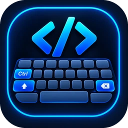
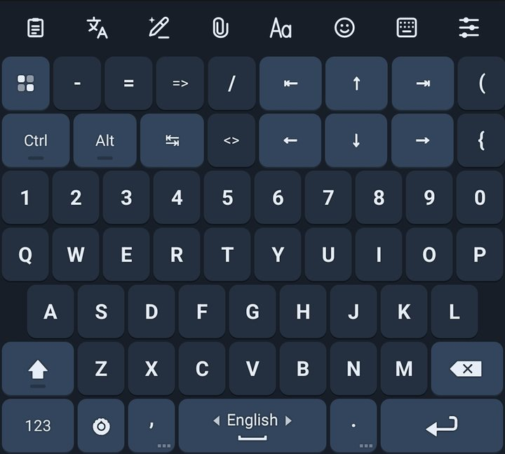
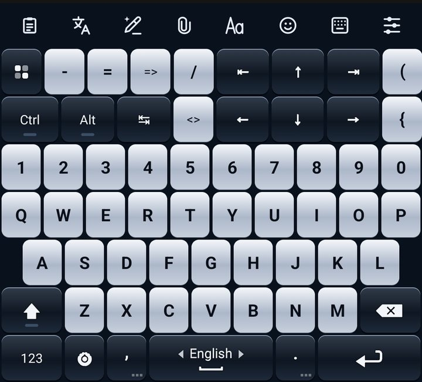
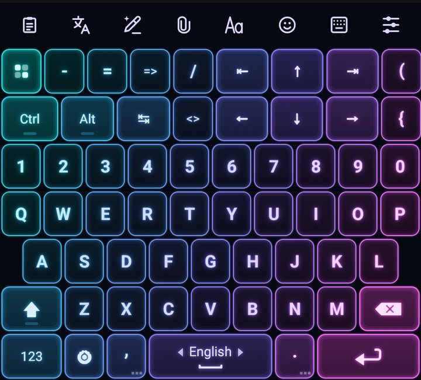

<div align="center">



# Mr Keyboard

**Um teclado Android para quem usa muito o celular: teclas completas de PC, folhas de teclas editáveis, comandos do Tasker, digitação por gestos, edição com IA e sugestões offline e privadas.**

[](https://github.com/x-mrrobot-x/mr-keyboard/releases/latest)
[](https://github.com/x-mrrobot-x/mr-keyboard/releases)
[](https://github.com/x-mrrobot-x/mr-keyboard/actions/workflows/mr-checks.yml)
[](#instalação)
[](LICENSE)

[English](README.md) · **Português**

[Baixar](https://github.com/x-mrrobot-x/mr-keyboard/releases/latest) · [Recursos](#recursos) · [Instalação](#instalação) · [Privacidade](#privacidade) · [Como compilar](#como-compilar)

<br>





<sub>Midnight Steel (padrão) · Chrome · Aurora, três dos doze temas</sub>

</div>

## Recursos

### Teclas e layout
- **Teclado completo de PC:** Ctrl, Alt, Esc, Tab, setas, Home/End, PgUp/PgDn e teclas de função, em layout compacto ou completo (configurações separadas para retrato e paisagem).
- **Folhas de teclas:** páginas extras de teclas abertas pelo próprio teclado: **123**, **TSK** (Tasker), **HTML**, **FRS** (frases), navegação e teclado numérico. Edite as folhas e crie as suas em *Configurações → Folhas*.
- **Comandos do Tasker:** uma tecla pode disparar uma tarefa do Tasker em vez de digitar ([como](#integração-com-o-tasker)).
- **Gestos:** deslizar para cima, baixo, esquerda ou direita, e as teclas de volume, executam ações do teclado (por padrão, esquerda e direita trocam de folha). O deslize para os lados vale pela distância, não pela velocidade. [Detalhes](docs/swipe-actions.md) (em inglês).
- **Apagar por palavra (desde a 2.0.0):** com o Ctrl ativo, a tecla apagar remove uma palavra por toque e, segurando, vai palavra por palavra no intervalo que você definir. O **Ctrl + Z** devolve as palavras uma por vez e o **Ctrl + Y** apaga de novo a que voltou (ficam guardadas por 2 minutos). Vem ligado; *Configurações → Toque e gestos → Apagar por palavra*. [Detalhes](docs/word-delete.md) (em inglês).
- **O seu visual:** doze temas, espaçamento e arredondamento das teclas, tamanho dos rótulos, altura do teclado (retrato e paisagem) e altura da barra. Toque longo, força da vibração, volume do clique e prévia das teclas são ajustáveis.

### Barra de ferramentas
- **Área de transferência:** histórico do que você copiou; toque para inserir, segure para apagar.
- **Traduzir:** traduz o texto antes de enviar (Google Tradutor).
- **Editar com IA:** reescreve o texto selecionado, ou o que está antes do cursor, em um diálogo sobre o teclado. Estilos: Formal, Curto, Corrigir, Expandir, Amigável, Profissional, Pontuação e os seus; com opção de emojificar. Use qualquer serviço compatível com a OpenAI (Chat Completions), com o seu endereço (https), modelo e chave. [Detalhes](docs/ai-editor.md) (em inglês).
- **Anexos:** fotos, vídeos e arquivos enviados para o app em que você está digitando, com seleção múltipla e envio em lote.
- **Fontes:** 27 estilos de texto (negrito, itálico, cursivo, gótico, bolha, versalete, tachado e outros) que funcionam em qualquer app.
- **Emojis:** recentes, todas as categorias, 170 emojis mais novos (mostrados só quando a fonte do celular consegue desenhá-los) e **pesquisa** em português, inglês e espanhol ao mesmo tempo (“coração”, “heart” e “corazón” encontram o mesmo emoji). [Detalhes](docs/emoji-search.md) (em inglês).
- **Personalizar teclado:** ajuste rápido de altura, espaçamento das teclas, tamanho dos rótulos, arredondamento das teclas e altura da barra, com botão para restaurar.
- **Mostrar/ocultar:** a tecla de grade, no canto superior esquerdo do teclado, oculta ou mostra a barra; as ferramentas voltam sozinhas depois que você digita (o tempo é ajustável).

### Digitação
- **Sugestões, correção e previsão da próxima palavra** em português do Brasil, inglês americano e espanhol, tudo no aparelho. Vêm ligadas: baixe o dicionário do seu idioma quando a barra de sugestões oferecer, ou em *Configurações → Sugestões e dicionários*.
- **App leve:** os dicionários são baixados quando você quiser, então o app em si tem cerca de 1 MB. Cada idioma baixado entra no teclado: deslize a barra de espaço para os lados para alternar entre eles.
- **Aprende o que você digita** (nunca em campos de senha ou anônimos) e sugere os nomes e as palavras que você acabou de escrever na mesma conversa (só na memória).
- **Minhas palavras:** *Configurações → Sugestões e dicionários → Minhas palavras* mostra o que o teclado aprendeu, deixa corrigir, bloquear e esquecer palavras (com cópia de segurança exportada) e adicionar nomes, gírias e frases a partir de um texto colado, de um arquivo ou de uma lista, com uma prévia antes de salvar, para todos os apps ou só para um app que você escolher (as palavras aparecem então só quando você digita nele). **Formatar com IA** transforma um texto solto nessa lista.
- **Digitação por gestos (vem ligada):** deslize o dedo de letra em letra e o teclado escreve a palavra, nos três idiomas. Ela também escreve as suas palavras, nunca uma palavra bloqueada, e mostra a palavra na faixa de sugestões enquanto você desliza. Precisa de um download único de cerca de 2,4 MB (*Configurações → Sugestões e dicionários → Digitação por gestos*) e depois roda no aparelho. [Detalhes](docs/gesture-typing.md) (em inglês).
- **Capitalização automática** (vem ligada) e **entrada de voz**.

### Temas
Doze temas: **Midnight Steel** (o padrão); os neon **Aurora** (as teclas mudam de tom ao longo do teclado), **Neon Cyan**, **Neon Purple**, **Neon Pink** e **Synthwave**; os claros **Aqua**, **Snow** e **Rose**; **Chrome** (teclas prateadas sobre azul-marinho); **Cobalt Glass** (translúcido) e **Denim**, os dois com blur de fundo no Android 12 ou mais novo. Ctrl, Alt e Shift mostram o estado com um pequeno traço colorido (Shift: inativo, ativo, travado). Como criar um tema: [docs/new-theme.md](docs/new-theme.md) (em inglês).

### O app
- **Idiomas:** português, inglês e espanhol; segue o idioma do sistema ou escolha em *Configurações → Geral → Idioma do app*.
- **Atualização pelo próprio app:** aviso de versão nova com as novidades, **Baixar e instalar** e um APK assinado e conferido ([como funciona](#atualizações)).
- **Desempenho:** *Configurações → Avançadas → Desempenho → Diagnóstico do teclado* mostra quanto o teclado leva para abrir, digitar e sugerir no seu celular, e a memória do dicionário em uso.
- **Restaurar padrões** em *Configurações → Geral*.

## Instalação
Precisa de Android 8.0 ou mais novo.

1. Baixe o APK (`mr-keyboard-v<versão>.apk`) na [última versão](https://github.com/x-mrrobot-x/mr-keyboard/releases/latest) e instale.
2. Abra o **Mr Keyboard**. A tela **Primeiros passos** guia você: ligue o Mr Keyboard na lista do Android (aceite o aviso do sistema, que o Android mostra para qualquer teclado que não veio com o celular), escolha-o como teclado em uso e baixe o dicionário do seu idioma e o arquivo da digitação por gestos (cerca de 2,4 MB). Dá para pular e fazer cada parte depois.
3. Sem os Primeiros passos: toque em **Ativar teclado** e depois em **Definir método de entrada** na tela principal.
4. Baixe o que as sugestões e a digitação por gestos usam: toque em **Baixar dicionário** na barra de sugestões, ou abra **Sugestões e dicionários** nas configurações e toque no seu idioma (e no arquivo da digitação por gestos). Baixando mais de um idioma, deslize a barra de espaço para os lados para alternar entre eles.

## Atualizações
- O app procura versão nova quando abre (no máximo uma vez por dia) e toda manhã em segundo plano. Quando há uma, um diálogo (ou uma notificação, na verificação da manhã) mostra as novidades, com **Baixar e instalar**, **Abrir no GitHub** e **Agora não**. A linha **Procurar atualização** e os dois interruptores ficam em *Configurações → Sobre*, onde tocar em **Versão** mostra as novidades da versão instalada, sem precisar de internet.
- **Baixar e instalar** baixa o APK dessa release, confere o tamanho e o SHA-256 com o `update.json` assinado e entrega ao Android, que pede a sua confirmação. Na primeira vez, o Android também pede que você permita ao Mr Keyboard instalar apps (*Instalar apps desconhecidos*).
- A verificação da manhã pede ao Android que rode depois das 8h (horário do celular), quando houver rede. Quem decide o momento exato é o Android: com economia de bateria, ou em celulares que colocam apps para dormir (alguns Samsung, Xiaomi e Huawei, por exemplo), o aviso pode chegar com horas de atraso ou não chegar. A verificação ao abrir o app sempre roda. No Android 13 ou mais novo, o aviso precisa da permissão de notificações.
- Dá para atualizar à mão: baixe o novo APK na [última versão](https://github.com/x-mrrobot-x/mr-keyboard/releases/latest) e instale por cima do antigo (precisa estar assinado com a mesma chave).

## Integração com o Tasker
Toda tecla cujo texto de saída comece com `tskcmd:` envia um comando em vez de digitar. A primeira fileira da folha **TSK** já traz algumas, e você pode criar as suas no editor de folhas (ex.: texto de saída `tskcmd:luzes_on`).

No Tasker:
1. Crie um perfil: *Evento → Sistema → Intent Received* (o nome pode aparecer traduzido no seu Tasker).
2. Em *Ação*, coloque `com.mrkeyboard.app.TASKER_CMD`.
3. Na tarefa, a variável `%cmd` traz o comando (no exemplo, `luzes_on`).

O comando vai num broadcast que outros apps também podem receber, então não coloque senhas nem dados pessoais nele.

## Privacidade
- O que você digita fica no aparelho. Sugestões, correções e palavras aprendidas são processadas e guardadas só no celular. Não há anúncios, análise de uso nem Google Play Services.
- O app se conecta à internet só para estes recursos:
  - **Traduzir** envia ao Google Tradutor (`translate.googleapis.com`) o texto que você digita no campo de tradução. Só esse texto, e só quando você usa. O próprio campo avisa ("Digite para traduzir com o Google").
  - **Editar com IA** envia somente o texto que você escolhe reescrever, e apenas ao serviço de IA que configurar. Nada é enviado até você tocar num estilo.
  - **Dicionários** (*Configurações → Sugestões e dicionários*): o app só se conecta quando você toca em *Procurar atualizações*, *Baixar*, *Atualizar* ou em um idioma que ainda não foi baixado, e só baixa arquivos da [release mais recente](https://github.com/x-mrrobot-x/mr-keyboard/releases/latest) deste repositório (o catálogo, `catalog.json`, e o zip de cada idioma, anexado à release em que aquele idioma mudou pela última vez). Cada arquivo é conferido com uma lista assinada com a chave do próprio app antes de ser usado.
  - **Digitação por gestos** (mesma tela): o arquivo de que ela precisa (o reconhecimento de gestos) é baixado do mesmo jeito, das mesmas releases, e só quando você toca em *Baixar* ou *Atualizar* no diálogo dele; *De um arquivo* instala sem nenhuma conexão. Depois disso o reconhecimento roda no celular: o caminho do dedo não é enviado para lugar nenhum.
  - **Primeiros passos** (a tela mostrada quando o app abre, para ativar o teclado, escolhê-lo e baixar o que ele precisa): só se conecta quando você toca em *Baixar* ou *Tentar de novo* em uma etapa, para pegar o dicionário do idioma do sistema ou o arquivo de gestos, das mesmas releases e com as mesmas verificações. As etapas de ativar e escolher o teclado só abrem as configurações do Android; *Pular* e *Desligar* não se conectam a nada. [Detalhes](docs/first-steps.md) (em inglês).
  - **Atualizações do app** (*Configurações → Sobre*): o app lê o `update.json` da [release mais recente](https://github.com/x-mrrobot-x/mr-keyboard/releases/latest) deste repositório quando abre (no máximo uma vez por dia) e toda manhã em segundo plano, e mostra um aviso quando há versão mais nova. As duas verificações podem ser desligadas. O pedido não leva nada sobre você nem sobre o celular. O arquivo é conferido com uma assinatura feita com a chave do próprio app antes de ser usado.

| Permissão | Para quê |
|---|---|
| Internet | Traduzir, editar com IA, baixar dicionários e o reconhecimento de gestos, e avisos de atualização |
| Notificações | Notificação fixa opcional para abrir o teclado e o aviso de versão nova |
| Instalar apps desconhecidos | *Baixar e instalar* entrega o novo APK ao Android, que pede a sua confirmação |
| Iniciar com o sistema | Mantém a verificação da manhã agendada depois que o celular reinicia |
| Armazenamento / Acesso a todos os arquivos | Anexos: listar e enviar suas fotos, vídeos e arquivos |
| Dicionário do usuário | Ler e adicionar palavras ao dicionário pessoal do Android |
| Vibração | Vibrar ao tocar nas teclas |

## Como compilar
O repositório é um projeto do [apktool](https://apktool.org/) (código smali e recursos), mais `native/` (leitor de dicionário em C++, `libjni_pckeyboard.so`), `engine/` (motor nativo de sugestões, `libmrengine.so`), `dicts/` (pacotes de dicionário), `gesture/` (dados do reconhecimento de gestos) e `docs/` (anotações de cada versão e as ferramentas).

```sh
apktool b . -o mr-keyboard-unsigned.apk
zipalign -p -f 4 mr-keyboard-unsigned.apk aligned.apk
apksigner sign --ks sua-chave.jks --out mr-keyboard.apk aligned.apk
```

Toda release também tem o `mr-keyboard-v<versão>-source.zip`, feito do commit exato que foi publicado. Compilar a partir do zip, workflows do GitHub Actions, assinatura, dicionários e como uma release é publicada: **[docs/building.pt-BR.md](docs/building.pt-BR.md)**.

## Documentação
[Compilar e publicar](docs/building.pt-BR.md) · [Digitação por gestos](docs/gesture-typing.md) · [Primeiros passos](docs/first-steps.md) (em inglês) · [Apagar por palavra](docs/word-delete.md) · [Gestos de deslize](docs/swipe-actions.md) · [Pesquisa de emojis](docs/emoji-search.md) · [Editar com IA](docs/ai-editor.md) · [Recursos de sugestão](docs/suggestion-features.md) · [Palavras para um app](docs/app-words.md) (em inglês) · [Motor nativo](docs/native-engine.md) · [Medidor de desempenho](docs/performance-meter.md) · [Novo tema](docs/new-theme.md) · [Notas de cada versão](docs/release-notes)

Os documentos técnicos de `docs/` estão em inglês, exceto o guia de compilação, que também tem versão em português.

## Verificar uma release
As releases são [imutáveis](https://docs.github.com/en/code-security/concepts/supply-chain-security/immutable-releases) (veja [Publicar](docs/building.pt-BR.md#publicar-para-quem-mantém-o-projeto)): depois de publicadas, os arquivos e a tag não mudam. O APK e o zip do código são gerados pelo workflow *Mr Keyboard - APK* deste repositório a partir do commit da tag, e cada um tem uma atestação de procedência assinada. Com o [GitHub CLI](https://cli.github.com/), na pasta onde você salvou o arquivo (troque a versão):
```sh
gh release verify v2.0.0 --repo x-mrrobot-x/mr-keyboard
gh release verify-asset v2.0.0 mr-keyboard-v2.0.0.apk --repo x-mrrobot-x/mr-keyboard
gh attestation verify mr-keyboard-v2.0.0.apk --repo x-mrrobot-x/mr-keyboard
```
O primeiro confirma que a release existe e é imutável, o segundo que o seu arquivo é exatamente o que está anexado a ela, e o terceiro que ele foi gerado pelo workflow deste repositório (vale igual para o `mr-keyboard-v2.0.0-source.zip`). Sem o CLI, compare o SHA-256 que aparece no texto da release com o `sha256sum <arquivo>`. Use o zip anexado pela release, não o zip *Source code* que o GitHub gera sozinho: aquele é criado na hora do pedido e não dá para verificar.

## Créditos e licenças
O Mr Keyboard está sob a [Apache License 2.0](LICENSE).
- [Hacker's Keyboard](https://github.com/klausw/hackerskeyboard), de Klaus Weidner, e o LatinIME do Android Open Source Project, em que o Mr Keyboard se baseia, também estão sob a Apache License 2.0.
- Dados dos dicionários (créditos completos em `dicts/<idioma>/NOTICE.txt`):
  - listas pt_BR, en_US e es do AOSP (Apache 2.0);
  - [Leipzig Corpora Collection](https://wortschatz-leipzig.de/) (CC BY 4.0);
  - [Tatoeba](https://tatoeba.org/) (CC BY 2.0 FR);
  - [OpenSubtitles](https://opus.nlpl.eu/OpenSubtitles/) via OPUS (só contagens de palavras e pares; nenhum texto de legenda é guardado nem distribuído);
  - Comentários de comunidades públicas do [Reddit](https://www.reddit.com/) (janeiro a junho de 2025), obtidos do arquivo [Arctic Shift](https://arctic-shift.photon-reddit.com) (só contagens de palavras, pares e trios; nenhum comentário, nome de usuário ou texto é guardado nem distribuído; a licença do texto não é clara, por isso só se usam contagens).
- A digitação por gestos (desde a 1.96.0; `docs/gesture-typing.md`) é feita com a tecnologia "FUTO Swipe": `gesture/encoder.bin` guarda os pesos do codificador [FUTO Swipe](https://huggingface.co/futo-org/futo-swipe), da FUTO Holdings, Inc., sem modificação. Esse arquivo é derivado do FUTO Swipe e está sob a **FUTO Model Weights License 1.0** (`gesture/LICENSE-FUTO-Model-Weights.md`), não sob a Apache License; o código que o executa é deste projeto. O APK não leva os pesos: o app os baixa como um pacote (`mr-keyboard-model-gesture-<versão>.zip`, com o texto da licença dentro) quando você liga a digitação por gestos, e a tela de ajustes mostra o aviso que a licença pede. O Mr Keyboard não tem ligação com a FUTO além dessa licença. Os gestos dos testes (`gesture/test/`) vêm do [conjunto swipe.futo.org](https://huggingface.co/datasets/futo-org/swipe.futo.org) (MIT License, Copyright (c) 2025 FUTO). Detalhes em `gesture/README.md`.
- Os nomes e as palavras-chave da pesquisa de emojis (`res/raw/mr_emoji_*.txt`, desde a 1.97.0; `docs/emoji-search.md`) vêm das anotações do [Unicode CLDR](https://cldr.unicode.org/), versão 49, Copyright © 1991-2026 Unicode, Inc., sob a **Unicode License v3** (`docs/LICENSE-Unicode-CLDR.txt`, <https://www.unicode.org/copyright.html>), e não sob a Apache License. Só as palavras dos emojis do painel foram mantidas.
